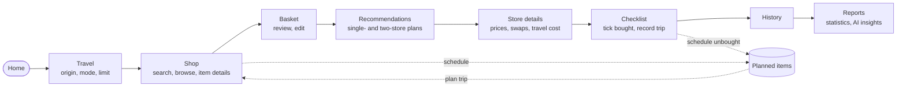

# Product overview

## What SmartCart is

SmartCart is a mobile-first web app that helps Malaysian households plan essential grocery shopping at the lowest *total* cost — item prices **plus** the cost of getting to the store. It is built by team TM17 for FIT5120 (2026 S2) and targets UN Sustainable Development Goal 10 (Reduced Inequalities): lower-income households spend a larger share of income on essentials, so small, honest savings matter most to them.

The app uses the government's open **PriceCatcher** dataset (item prices observed at thousands of Malaysian premises) and shows **SARA** (Sumbangan Asas Rahmah) eligibility signals so recipients can see where their credit is likely usable.

## Who it is for

| User | Need SmartCart addresses |
| --- | --- |
| Budget-constrained household shopper | Which nearby store gives the cheapest basket once travel is included? |
| SARA credit recipient | Which items and stores are likely SARA-eligible, and how much cash will I still need? |
| Shopper without a car | Compare walking and public transport honestly, not just driving. |
| Malay- or English-speaking shopper | Full UI in English and Bahasa Melayu. |

No account is required. Personal shopping data stays in the browser unless the shopper opts in to AI reports (see [Security and privacy](../03-architecture/security-and-privacy.md)).

## Core journey

The steps bar (Travel → Shop → Basket → Recommendations → Store details → Checklist) guides the shopper and locks steps that are not yet possible (for example, Recommendations with an empty basket).

## Feature map

| Epic | Capability | Key user outcome |
| --- | --- | --- |
| 0 | App shell, home, navigation, language | Start or resume a trip; switch English/Malay |
| 1 | Essential basket building | Search, browse by category, add quantities, review basket |
| 2 | Reachable store recommendation | Rank reachable stores by basket + return travel cost; nearby prices while shopping |
| 3 | Smart budget alternatives | Cheaper equivalents and better-value pack sizes at the chosen store |
| 4 | Price history, forecasting, planned items | National weekly price history, 4–12 week forecasts for qualifying items, schedule purchases by week, planned items and their forecasts reachable while shopping |
| 5 | Checklist and trip tracking | Shop from a checklist, record trips, export, track tolls, schedule unbought items |
| 6 | Multi-store recommendations | Optional two-store plans with inter-store travel limits |
| 7 | Healthier alternatives and nutrition | Curated healthier swaps with transparent nutrient comparisons |
| 8 | Progress reports | Weekly/monthly statistics, estimated savings, opt-in AI-written insights |

Full stories and acceptance criteria: [Requirements](../02-requirements/README.md).

## Principles that shape every feature

1. **Never invent numbers.** Missing prices, routes, nutrients or forecasts are shown as unavailable, never as zero.
2. **Label estimates.** Median prices (with the range they come from), straight-line travel, forecasts and savings are always marked as estimates.
3. **A price is not stock.** A PriceCatcher observation does not prove an item is on the shelf today.
4. **SARA states stay distinct.** *Verified*, *candidate* and *unverified* are never merged; unknown is not "ineligible".
5. **Privacy by default.** Location is never stored on the server; it is kept on the device only with the trip in progress and the active checklist, and is never sent with reports. Trips, checklists and plans stay on the device.

The reasoning behind these is in [Design decisions](../03-architecture/design-decisions.md).

## Team

| Member | Main areas (from git history and board assignments) |
| --- | --- |
| Shunnosuke Takei | Main developer: architecture, data pipeline, Epics 0, 2, 4, 5, reports |
| Chenglong Meng (git: "Randy Mong") | Epic 6 multi-store planning, Epic 8 statistics and savings, catalogue search |
| Zhihao Zhao | Epic 7 healthier alternatives, item details, pack sizes, checklist export, trip history |
| Huan Yang | Figma prototypes, e-portfolio, basket editing story |
| Wei Yuan Tan | Project governance documents (architecture, data governance, risk, security) |

File-level ownership: [Code ownership](../09-team/code-ownership.md).
