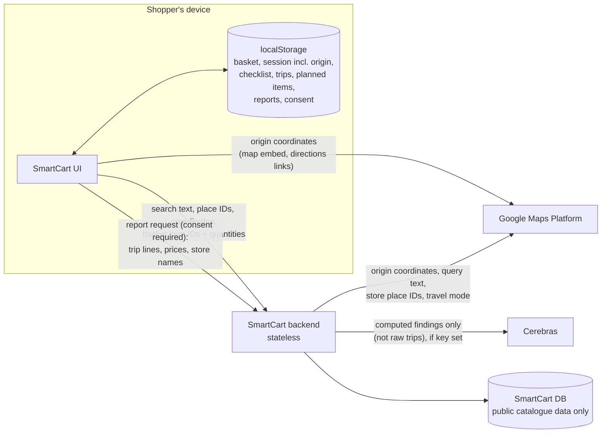

# Security and privacy

SmartCart has no user accounts and the server database holds no personal data. The privacy-relevant paths are: what the browser stores, what it sends to the SmartCart backend, and what the backend forwards to third parties.

## Data flows

## What is sent where

| Destination | Data | When | Stored by SmartCart? |
| --- | --- | --- | --- |
| SmartCart backend | Catalogue search text, filters, sort, locale | Shop screen | No |
| SmartCart backend → Google Places | Location search text (≥ 3 chars), session token, chosen place ID | Travel screen | No |
| SmartCart backend → Google Geocoding | Device latitude/longitude | "Use precise location" (best-effort label) | No |
| SmartCart backend → Google Routes | Origin coordinates, candidate store place IDs, travel mode | Recommendations (only for routes not already cached) | Route results for 30 min: home legs in process memory only, under a hashed key; store-to-store legs (no personal data) also in PostgreSQL |
| Google Maps, directly from the browser | Origin latitude/longitude (map embed); origin, store names and addresses (directions links) | Travel screen map; "Open in Google Maps" links | No |
| SmartCart backend | Basket item IDs and quantities | Recommendations, store alternatives | No |
| SmartCart backend | Report request: period, locale, and per trip: recorded time, bought line names, categories, quantities, unit prices and totals, unbought line names, store name, travel and plan estimates, cheapest alternative store estimate, estimated savings. **No origin or route.** | Generate report, only after consent | No (report returned, not persisted) |
| Cerebras | Up to four computed findings: kind, direction, formatted values (may include item names, store names, amounts), template text; locale and cadence | Report generation, only if `CEREBRAS_API_KEY` is set | No |
| data.gov.my | Nothing about the shopper (server fetches the public fuel CSV) | First car/motorcycle request each day | — |

The consent text in the Reports screen lists these fields in English and Malay. Consent is versioned (`smartcart.report-consent.v1`, record version 2); a choice made under an older disclosure is treated as undecided and asked again.

## What stays on the device

| Key | Contents | Cleared when |
| --- | --- | --- |
| `smartcart.shopping-session.v1` | Basket, travel preferences **including origin label and coordinates**, resume step, selected store | Trip finished/cleared (no origin and empty basket) |
| `smartcart-travel-preferences` | Mode, limit, SARA filter — **never the origin** | "Remember preferences" turned off |
| `smartcart.shopping-checklist.v1` | Active checklist, including origin coordinates for the map link | Checklist deleted or replaced |
| `smartcart.trip-history.v1` | Recorded trips (no origin) | Shopper deletes a trip |
| `smartcart.next-trip.v1` | Planned items and weeks | Item removed or bought |
| `smartcart.inbox.v1` | Generated reports and weekly/monthly choice | "Delete all reports" |
| `smartcart.report-consent.v1` | Consent status and timestamp | Changed in Report settings |
| `smartcart.report-language.v1`, `smartcart-locale` | Language choices | — |

Risk to note in governance documents: on a shared device, anyone using the same browser profile can see these records.

## Controls in code

| Control | Where |
| --- | --- |
| Provider keys only in backend environment; never `NEXT_PUBLIC_*` | `backend/smartcart/config.py`, `backend/.env.example` |
| CORS limited to configured origins; methods GET/POST/OPTIONS; header `Content-Type` | `backend/main.py` |
| `Cache-Control: private, no-store` on every `/api/` response | `backend/main.py` |
| Routes cache never writes a shopper's origin to the database: home legs are memory-only under a SHA-256 key; the shared table holds store-to-store legs keyed by place IDs | `backend/smartcart/route_cache.py` |
| Stable error envelope; no stack traces or provider messages to clients | `backend/smartcart/errors.py` |
| Input validation: coordinates, enums, travel limits (0.5–100 km, 5–180 min), item IDs, query lengths | `backend/smartcart/models.py`, `api.py` |
| Report size limits: 512 KiB body read before parsing, ≤128 trips, ≤1,000 lines, item names ≤200 chars | `backend/smartcart/report_models.py`, `api.py` |
| Report logs record counts and timings only, never request bodies | `api.py` (`generate_report_endpoint`) |
| LLM output validated per insight; numbers only via placeholders; prompt treats context as data | `backend/smartcart/cerebras_narrator.py` |
| Parameterised SQL everywhere | all data-access modules |
| Rate-limit hook for report generation (`report_rate_limit_hook`) | `backend/main.py`, `reporting.py` |

## Known gaps

| Gap | Status |
| --- | --- |
| The report rate-limit hook defaults to *allow everything*. A deployment must inject a real limiter. | Not configured in the repository |
| Google-derived premise coordinates must be deleted after 30 days. `.github/workflows/premise-locations.yml` deletes them and refreshes due ones daily, and `premises.py` ignores any Google coordinate older than 30 days. | Needs a successful production run as evidence |
| Other endpoints have no rate limiting; Google cost is bounded only by per-request caps and Google Cloud quotas. | Configure quotas and budget alerts |
| Browser storage is unencrypted and shared by everyone using the browser profile. | Accepted trade-off (see [D8](design-decisions.md#d8-personal-data-stays-on-the-device-no-accounts)) |

## Data licences and attribution

| Source | Licence / terms |
| --- | --- |
| PriceCatcher (data.gov.my) | CC BY 4.0 — attribution required in product and docs |
| data.gov.my fuel prices | data.gov.my open data terms |
| Google Maps Platform | Service-specific terms: no Google route content on a non-Google map; attribute Google; cached coordinates ≤ 30 days; route distances and durations cached for 30 minutes only |
| USDA FoodData Central | Public domain (CC0 1.0) |
| AFCD (Food Standards Australia New Zealand) | Published reference data; attribution conditions apply |
| MyFCD (Ministry of Health Malaysia) | Public government reference; no explicit open licence; used with attribution |
| MyKasih SARA merchant list | Authorised collection; raw files are not committed; redistribution restrictions apply |
