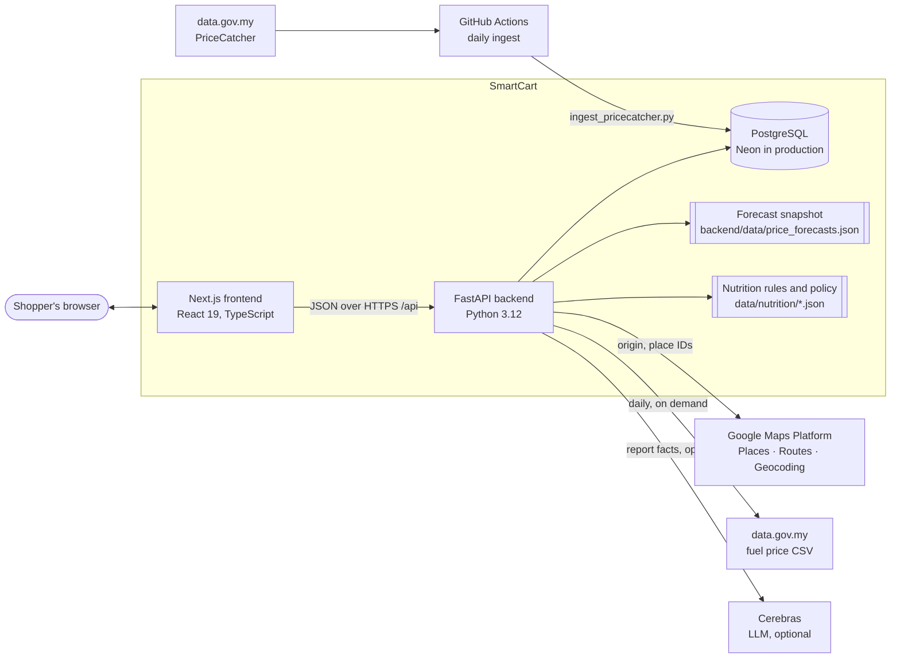
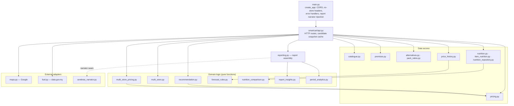
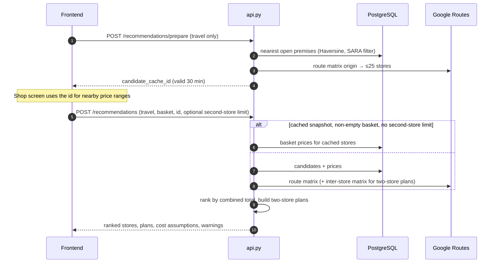
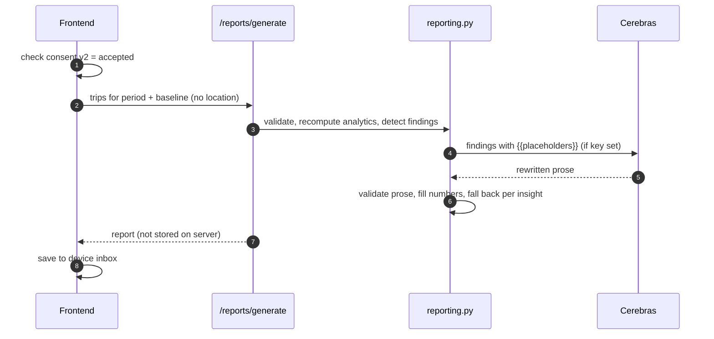

# System architecture

## Context

| Component | Responsibility | Location |
| --- | --- | --- |
| Frontend | All screens, client-side state, device storage (basket, checklist, trips, planned items, reports), checklist export, statistics | `frontend/` |
| Backend | Catalogue search, location proxy, store ranking, multi-store planning, alternatives, price history, nutrition, report generation | `backend/` |
| Database | PriceCatcher catalogue, premises, latest prices, nutrition records | `database/schema.sql`, `database/migrations/` |
| Forecast snapshot | Pre-computed weekly history and forecasts for 796 items | `backend/data/price_forecasts.json` |
| Nutrition files | Healthier-alternative mappings, rules and comparison policy | `data/nutrition/` |
| Data jobs | PriceCatcher ingestion, enrichment, migrations, imports | `database/*.py`, `.github/workflows/pricecatcher.yml` |

## Backend layering

Domain modules take plain inputs and return Pydantic models or dataclasses, so ranking, routing rules, eligibility and report findings are unit-tested without a database or Google key. Data-access modules each open a short-lived connection (`database.py`) per request; there is no ORM.

## Key request flows

### Store recommendation (Epics 2 and 6)

If Google Routes is not configured or fails, the backend switches to the straight-line fallback (25 nearest stores, planning speeds, limits not verified) and says so in `route_warning`. Details: [Store recommendation](../04-backend/store-recommendation.md).

### AI report (Epic 8)

Details: [Reports and analytics](../04-backend/reports-and-analytics.md).

## Where state lives

| State | Lives in | Lifetime |
| --- | --- | --- |
| Catalogue, premises, prices, nutrition | PostgreSQL | Refreshed daily (prices) or by migration |
| Price history and forecasts | JSON snapshot in the backend | Replaced by an offline batch run |
| Candidate snapshot | Backend process memory (LRU, 128 entries) | 30 minutes |
| Fuel price | Backend process memory | One Malaysian day; failures retried hourly |
| Origin (location) | Frontend memory; also inside the device-held shopping session (for resume) and the active checklist (for its map link) | Until the trip is cleared; never written to the SmartCart database |
| Basket, checklist, trips, planned items, reports, consent | Browser `localStorage` | Until the shopper deletes them |

Device record shapes are in the [Data model](../05-data/data-model.md#device-data-model).

## Technology choices (summary)

| Layer | Choice | Version source |
| --- | --- | --- |
| Frontend | Next.js 15, React 19, TypeScript, Tailwind 4, Recharts, html-to-image | `frontend/package.json` |
| Backend | FastAPI, Pydantic 2, psycopg2, Cerebras SDK | `backend/requirements.txt` |
| Database | PostgreSQL 16 locally (Docker), Neon in production | `database/docker-compose.yml` |
| Data jobs | pandas, fastparquet, psycopg 3 | `database/requirements.txt` |
| Tests | pytest, Vitest | `backend/requirements-dev.txt`, `frontend/vitest.config.mjs` |

Rationale for each: [Design decisions](design-decisions.md).
