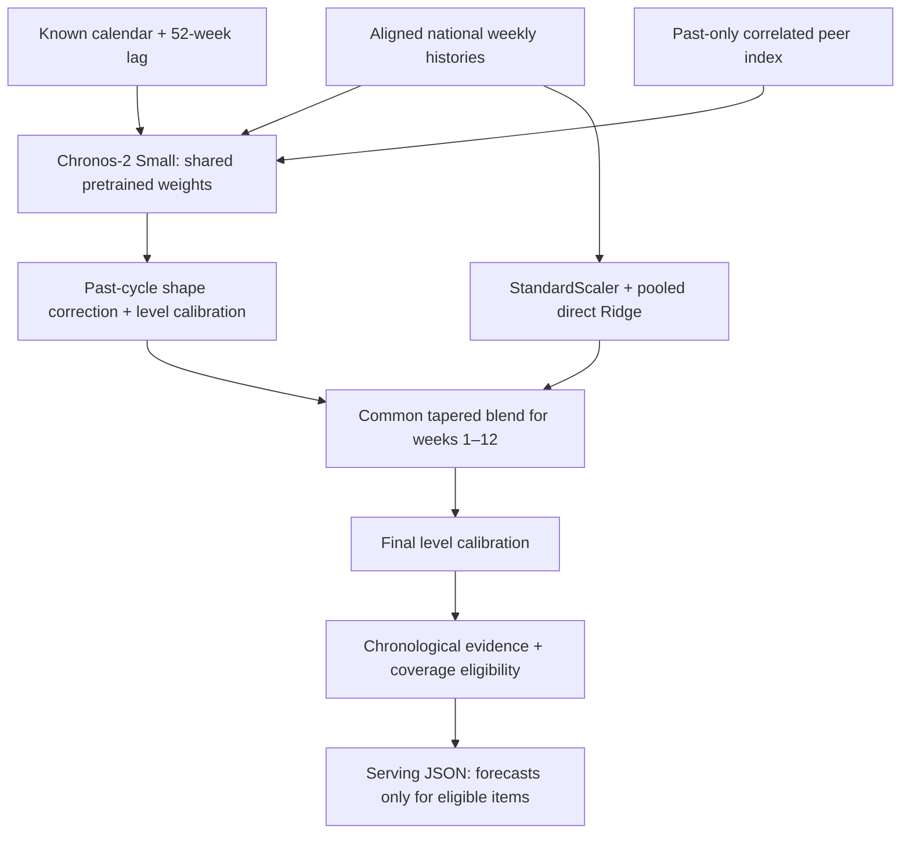

# Forecasting methodology, model architecture and training

This document describes the `chronos_2_small_ridge` pipeline behind the committed 9 October 2026 snapshot. The [feature guide](price-history-and-forecasts.md) covers eligibility, API behaviour and the shopper interface. Parameter values below were checked against the snapshot, local research source and checkpoint configuration on 12 October 2026.

## Target and data preparation

The target is a **national weekly price in RM for a PriceCatcher item/package**, not a particular store's future price, an inflation index, stock availability or shopper demand.

1. Read monthly PriceCatcher parquet files from `raw/`, restricted to the source cutoff and lookup items. Exclude non-positive prices and invalid premise codes.
2. Assign observations to Monday-starting weeks. Carry unfinished weeks across monthly file boundaries so a week is aggregated once.
3. Compute the median observed price for each item/store/week, then the median of those store medians for the national item/week. This gives each surveyed store equal weight regardless of how many observations it contributes.
4. Align items on a weekly calendar starting 3 January 2022. Preserve absent observations as JSON `null` / numerical `NaN`, with store and observation counts alongside prices.

The current history contains 246 weekly positions through the week starting 14 September 2026; `data_cutoff = 2026-09-20` is the final allowed observation date. A missing week is not a zero price. The current Chronos inputs use native missing-value masks; ridge labels are actual positive observations only. Some older experimental signal diagnostics use forward filling within a historical prefix; that is not the serving model's training-label policy.

Coverage diagnostics count observed weeks, missing weeks and observations. Recent coverage is the observed fraction of the last 12 calendar weeks; recent store coverage is the median weekly store count over that window. The item-definition check rejects names containing `PELBAGAI` as mixed-brand definitions; it is a heuristic, not an independent package audit.

Store-composition checks compare movements in the national median with median price changes among stores observed in adjacent weeks. Missing audit evidence also blocks eligibility. This helps detect changes caused by the survey's store mix, but does not make the series a fixed-store panel or a population-weighted national index.

## Model architecture



### Pretrained foundation model

All items use `autogluon/chronos-2-small`, revision `ddec01313e50b6bc58ebaa92ede81bc24a3d9f9a`. The pinned local `config.json` specifies `Chronos2Model` / `Chronos2Pipeline`, six layers, eight attention heads, model width 512, feed-forward width 2,048 and input/output patches of 16 positions. Its configured context limit is 8,192 positions; SmartCart supplies the available weekly prefix, not 8,192 weeks of history. The configuration enables arcsinh transformation and includes 13 quantile levels from 0.01 to 0.99.

SmartCart requests only quantile 0.5, producing a 52-week median path. Offline inference uses CPU, float32, four Torch threads and batches of up to 32 tasks. `cross_learning=False`: each target task is forecast independently with the same checkpoint weights. Explicit peer covariates provide related-item information.

The selected input mode is `peer_past`:

| Input | Construction | Future availability |
| --- | --- | --- |
| Target | Item's national weekly history | Observed prefix only |
| Solar calendar | Sine/cosine terms at first and second annual harmonics, period 365.2425 days | Calendar-derived, known at origin |
| `price_lag_52` | Target shifted by 52 weeks | All 52 future covariate positions refer to already observed weeks |
| `peer_price_index` | Median normalised prices of qualifying related items | Past only; future peer prices are not supplied |

Peer selection excludes the target and ranks up to five items by positive correlation of four-week log-price changes over the last 104 changes. It requires at least 78 paired observations and correlation at least 0.35. Peer prices are normalised by their origin-known median over the last 104 weeks; an index point requires at least two observed peers. Items without a usable index retain the calendar/lag task. At least 104 positive observed target weeks are required to generate a Chronos path, beyond the general eligibility minimum of 52.

The selected shared shape correction has strength 0.25 and six Fourier harmonics. It derives a detrended seasonal template from up to three past 52-week cycles, requiring at least two usable cycles, and adjusts the raw path according to past shape agreement and amplitude. These historical per-series calculations do not train separate neural checkpoints or select a different model family for each item.

### Pooled ridge model

`SharedShortHead` is a direct regression for horizons 1–12. One `StandardScaler` and one `Ridge(alpha=100)` are fitted across all eligible item/origin/horizon rows. The response is `actual_future_price / latest_price_at_origin - 1`. The head predicts normalised price change; it does not predict a residual against Chronos.

Each row has 62 features:

- Seven relative price lags (1, 2, 4, 8, 13, 26 and 52 weeks) with missingness indicators: 14 columns.
- Relative mean, standard deviation and observed fraction over 4, 8, 13, 26 and 52 weeks: 15 columns.
- Aligned prior-year movement and its availability indicator, `h/12` and `(h/12)^2`: four columns.
- The first 29 columns interacted with `h/12`: 29 columns.

A prediction/training prefix requires at least 94 positive observations in its last 104 positions and an observed latest position. Missing feature values use neutral values plus indicators; missing targets never become labels. There are no item-ID coefficients, per-item ridge fits or recursive predictions. Predictions clip relative change to [-0.8, 3.0] and enforce a price floor of RM0.01. If a short-head prediction is unavailable, the blend retains the foundation path.

### Combining paths

For week `h` in 1–12, the ridge weight is:

```text
w(h) = 0.5 × exp(-(h - 1) / 12) × (13 - h) / 12
blended(h) = (1 - w(h)) × foundation(h) + w(h) × ridge(h)
```

The contribution tapers to zero at week 13; weeks 13–52 retain the foundation path. Shared level calibration is applied to the foundation control and again after blending: a prediction snaps to the latest observed price when its relative deviation is less than `0.05 × exp(-(h/16)^2)`. This suppresses small near-term movements; it is not an uncertainty interval.

## Training and model selection

The serving checkpoint is **pretrained and frozen**. SmartCart fits the ridge head locally and selects common input/calibration/blend settings. The research folder also contains neural fine-tuning, tree models, weather/economic inputs and other experiments; their presence does not mean they are used by the serving snapshot. `train_chronos2_shared.py` is an experimental fine-tuning route, not the training entry point for this model policy.

At each fit cutoff `origin`, the ridge training procedure:

1. Restricts all input data to indices strictly below `origin`.
2. Iterates historical training origins from index 104 to `origin - 1` and available horizons up to 12.
3. Builds features from the training origin's historical prefix and uses only positive, finite targets whose index is below the fit cutoff.
4. Fits scaling and ridge coefficients on the pooled training rows. All rows have equal regression weight.

Selection tests 19 shared configurations: a no-ridge control plus combinations of alpha {10, 100, 1,000}, blend weight {0.25, 0.5, 1} and decay {4, 12}. Selection uses an earlier pattern cohort derived at origin 142, with annual validation at 142 and short selection origins 156, 162 and 168. Ranking prioritises joint annual/short passes, annual passes and then short-pattern relative MAE, with deterministic tie breakers. The selected settings are alpha 100, weight 0.5, decay 12.

The last selection target index is 193. Later assessment begins at annual origin 194 and short origins 210, 222 and 234. The ridge is refitted at each assessment origin using only labels available then; the common hyperparameters stay frozen. A final pooled fit on the complete 246-position history generates current paths. The local promotion report records 495,375 final training rows; this number is evidence for that run, not a fixed pipeline constant.

## Backtesting and interpreting accuracy

An origin is the index of the first held-out week, using zero-based indices on the aligned history grid:

| Assessment | Origin | First target week | Role |
| --- | --- | --- | --- |
| Earlier annual | 142 | 2024-09-23 | Model/settings selection |
| Later annual | 194 | 2025-09-22 | Experimental annual diagnostics |
| Later short | 210 | 2026-01-12 | 4/8/12-week evidence |
| Later short | 222 | 2026-04-06 | 4/8/12-week evidence |
| Later short | 234 | 2026-06-29 | 4/8/12-week evidence |

The three later 12-week target blocks do not overlap. Nested 4-, 8- and 12-week scores within each block do overlap and are not nine independent forecast paths. Scoring uses observed target prices only and requires at least `max(3, 0.75 × horizon)` observed targets within a scored window.

- **MAE (RM):** mean absolute predicted-versus-observed error over the first `h` weeks, not only week `h`.
- **Relative MAE:** window MAE divided by the median historical price available before that origin. `coverage.test_relative_mae` is the worst short score across assessed origins and horizons. It is not MAPE, an accuracy percentage or a confidence probability.
- **Latest-price baseline:** repeats the last observed price at the origin. For each horizon, model and baseline MAEs are averaged across origins; `test_baseline_mae_ratio` is the largest horizon ratio. Both zero errors give ratio 1; positive model error against zero baseline error fails the gate.
- **Complete paths:** an origin with scores at all of 4, 8 and 12 weeks. Eligibility requires at least three complete paths, relative MAE at most 0.15 and baseline ratio at most 1.35, plus the coverage/composition rules in the [feature guide](price-history-and-forecasts.md#forecast-eligibility-forecast_ruleseligibility).

Earlier research selection uses additional pattern criteria and stricter pass definitions; those are not the current serving thresholds. The stored `shared_ridge.pattern_relative_mae` describes an earlier selection cohort, not overall performance for all 796 items. The snapshot stores per-item evidence rather than a single claimed universal accuracy.

The committed snapshot has 129 available, 387 rejected, 274 insufficient and six no-history records at its 9 October assessment. A local promotion report predates subsequent requalification and reports 80 qualified records; use the committed snapshot for serving counts. Requalification changes eligibility and forecast inclusion without refitting or changing predictions.

## Limitations and evidence boundaries

- Only 12 weeks are validated for the shopper interface. Stored 52-week paths and annual diagnostics remain experimental; annual-validation and current-shape gates are off in the serving policy.
- The API can return the stored 52-week path; the frontend limits display to the validated 12-week horizon. API consumers must respect `validated_horizon_weeks` themselves.
- The app publishes point estimates without calibrated prediction intervals. Requesting a median from Chronos does not establish coverage for the final corrected/blended estimate.
- Foundation pretraining-corpus overlap with this historical archive has **not been verified**. Local chronological cutoffs prevent future labels entering SmartCart's ridge fits and input features, but cannot certify independence from the foundation model's pretraining data.
- Historical research archives were reused during development. Later tests are chronological evidence, not a newly collected prospective trial or a guarantee against all research-selection bias.
- Survey coverage, mixed item definitions, sudden policy/supply shocks and changing store composition can undermine forecasts. Eligibility withdraws weak/stale series; it does not eliminate those risks.
- Daily PostgreSQL price ingestion does not refresh the independent forecast snapshot. Forecasts do not determine basket quotes, store ranking or actual spending.

## Reproducibility and source map

The deployed API needs only the committed snapshot and lightweight backend dependencies. The offline workspace, raw inputs, checkpoint cache, model code and experiment outputs are git-ignored. **A clean clone can serve forecasts but cannot retrain this model from repository contents alone.** Preserve or obtain the research bundle before trying to reproduce a run.

| Local source/artifact | Purpose |
| --- | --- |
| `research/price_forecasting/evaluate.py`, `build_history.py`, `national.py` | Weekly aggregation, history and coverage/composition evidence |
| `chronos2_model.py`, `chronos2_calendar_model.py`, `chronos2_lagged_model.py`, `chronos2_peer_context.py`, `chronos2_shape_correction.py`, `chronos_model.py` in that folder | Checkpoint adapter, covariates, peer selection, shape/level correction |
| `shared_short_head.py`, `shared_short_experiment.py`, `shared_short_holdout.py` | Ridge implementation, earlier selection, later assessment and current paths |
| `build_short_serving.py` | Reproduce paths/evidence and promote snapshot |
| `unified_results/*parameters.json`, `*provenance.json`, `shared_short_head_verification.json` | Frozen settings, input/cache/source hashes and verification |
| `unified_results/shared_short_head_holdout.csv`, `current_shared_short_head_paths.csv` | Backtest scores and saved paths |
| `backend/scripts/requalify_price_forecasts.py` | Committed eligibility-only maintenance tool |
| `backend/smartcart/forecast_rules.py`, `price_history.py` | Shared gates and runtime serving |

Research filenames above refer to the local bundle; they are intentionally not links to files available in a clean clone. The recorded runtime uses `chronos-forecasting==2.3.2`, `torch==2.13.0`, `transformers==5.15.0`, `huggingface-hub==1.27.0` and `scikit-learn==1.5.1`; retain the full research requirements and checkpoint manifest when transferring the bundle.

For reproducibility, preserve source parquet SHA-256 entries from `sources[]`, item ordering and the complete weekly grid, the exact reference snapshot named by the input hash, checkpoint revision/configuration/weights, research source hashes, selected settings, cached origin paths, assessment date and dependency manifests. Promotion verifies reference-input and source hashes, reproduces current paths within absolute tolerance `1e-9`, checks short evidence, preserves history and requires finite positive 52-week paths after the data cutoff.

These scripts form an experimental dependency chain, not an automated clean-clone training command. Several expect the exact pre-promotion snapshot hash; the currently served/requalified JSON need not match it. Refreshing source data requires rebuilding aligned histories, origin-specific covariates, backtests, audits and provenance before promotion. Requalification alone cannot perform that refresh. See the [operations runbook](../07-operations/deployment-and-operations.md#forecast-snapshot-maintenance) for safe serving updates.
