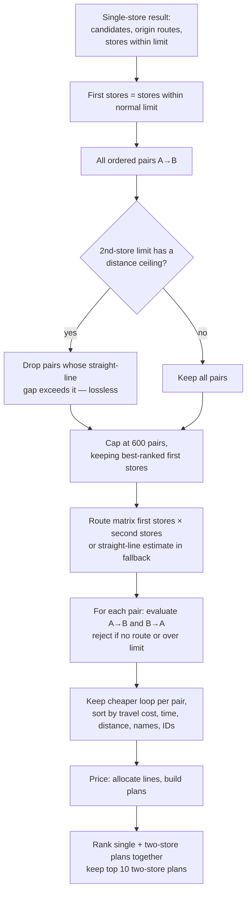

# Multi-store planning (Epic 6)

Optional two-store plans, ranked in the same list as single stores. Enabled when the request includes `secondStoreLimit`; otherwise the response is identical to Epic 2 and `multiStore` is null.

Code: `backend/smartcart/multi_store.py` (routing rules, pure), `multi_store_pricing.py` (allocation and comparison, pure), `api.py` (`_build_multi_store_plans`), `maps.py` (`compute_route_matrix_multi_origin`). Frontend: `frontend/lib/multi-store.ts`, `components/multi-store-panel.tsx`, `plan-comparison.tsx`, `plan-detail.tsx`.

## Rules at a glance

| Rule | Detail |
| --- | --- |
| Stores per plan | One or two |
| Line allocation | Each basket line's full quantity goes to one store; lines are never split |
| Origin → first store | Must satisfy the shopper's normal travel limit |
| First → second store | Must satisfy the second-store limit (distance, time or both, inclusive) |
| Second store vs. origin | Not checked against the normal limit; its return leg is still priced |
| Visit order | Both orders tried; the cheaper eligible loop is kept |
| Transport cost | origin → A + A → B + B → origin, each leg priced as one way |
| Presets | Distance 2/5/10/15 km, time 10/20/30/45 min — same as the Travel screen; no free input |

## Algorithm

### Routing (`multi_store.py`)

- `select_pairs_for_routing` builds ordered pairs (first store from the reachable set, second from all candidates). For distance/both limits it removes pairs whose Haversine gap already exceeds the limit — safe because a route cannot be shorter. Time-only limits keep every pair (roads may be faster than planning speeds). Above 600 pairs, the ordered pair list is cut at 600 (first stores are in rank order, so lower-ranked first stores lose their pairs first) to bound Google quota.
- `api.py` requests one multi-origin route matrix for the surviving pairs. In straight-line fallback mode it estimates the inter-store leg from Haversine distance and the mode's planning speed, and still applies both limits to these estimates.
- `_evaluate_direction` rejects an order if the inter-store route is missing, exceeds the second-store limit, or either home leg is missing. It never substitutes a made-up value.
- `plan_multi_store_trips` tries the reverse order only when the other store is itself a valid first store, keeps the cheaper eligible order per unordered pair, records the other order's cost (`reverseOrderCostRm`), and reports `evaluatedPairCount`, `unrouteablePairCount` and an `emptyReason`:

| `emptyReason` | Meaning |
| --- | --- |
| `insufficient_reachable_stores` | Fewer than two candidates, or no store within the normal limit |
| `no_pairs_within_limit` | No pair satisfies the second-store limit |
| `no_inter_store_route_data` | Every evaluated pair lacked route data |

### Pricing and comparison (`multi_store_pricing.py`)

`allocate_basket` assigns each line to one participating store:

1. candidate prices are that store's effective line (store price, else median, else none) with a positive unit price;
2. an observed **store price is preferred over a median**; among equals the lower unit price wins; ties keep premise-ID order;
3. a line priced at neither store is listed as missing.

`build_plan_comparison`:

- prices every single store that is within the normal limit and every two-store plan on the same basis;
- drops two-store plans where one stop would receive no items ("no plan with an empty stop");
- splits plans into **complete** (every line priced) and **incomplete**;
- sorts each group by combined total, then fewer stores, shorter time, shorter distance, then store IDs;

The API then keeps the ten best two-store plans (by combined total, time, distance, plan ID) and all single-store plans.

## Response shape

`multiStore` contains `plans[]` (routes: legs, inter-store distance/time, totals, provider), `comparison` (`completePlans[]`, `incompletePlans[]`, each with `assignments[]` per line and per-store subtotals), `stores` (single-store pricing for every participating store), `secondStoreLimit`, `emptyReason` and the pair counters.

## Frontend behaviour

- Multi-store is **off** by default. Turning it on opens the *Store plans* menu with the preset buttons; *Apply limits* is blocked until every active group has a preset (no hidden defaults).
- Changing the limit type requires pressing *Apply* again.
- `rankedStorePlanOptions` merges single stores and all two-store plans (complete and incomplete) into one list, sorted by combined total (unpriced last), then travel time, distance, name and ID. Single-store time and distance are doubled for the return trip. Incomplete plans show partial totals rather than a separate group,.
- A two-store plan can be opened, edited and saved as a checklist; the checklist, export and trip history then show which store each line belongs to (US 6.5).
