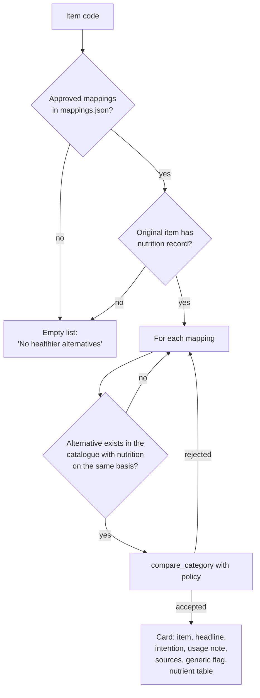

# Nutrition and healthier alternatives (Epic 7)

Two related features:

- **Item nutrition** (US 7.4): nutrient values for any mapped catalogue item, with source and a disclosure when the record is a generic food.
- **Healthier alternatives** (US 7.1–7.3): curated swaps for an item, each with a "Why this alternative?" nutrient comparison.

Code: `backend/smartcart/item_nutrition.py`, `nutrition_repository.py`, `nutrition.py`, `nutrition_comparison.py`. Data: `nutrition_food` table, `item.nutrition_food_id` / `item.nutrition_mapping_metadata`, and `data/nutrition/*.json`. Frontend: `components/item-nutrition.tsx`, `components/healthier-alternatives.tsx`, `lib/nutrition.ts`, `lib/item-stack.ts`.

## Where each piece of data lives

| Data | Location | Read at runtime from |
| --- | --- | --- |
| Nutrient values per food, per 100 g or 100 ml, with publisher provenance | `nutrition_food` table | Database |
| Item → food link, approval, generic/product match, rationale, basis variants | `item.nutrition_food_id`, `item.nutrition_mapping_metadata` | Database |
| Alternative rules and approved original → alternative mappings | `data/nutrition/mappings.json` | File (cached per process) |
| Comparison thresholds, priorities, required and guard nutrients | `data/nutrition/comparison_policy.json` | File |
| Import snapshots (`item_nutrition.json`, `foods.json`) | `data/nutrition/` | Import and audit only, never at runtime |

The database is the only runtime source for nutrient values; a database failure is reported as an error, never silently replaced with file values.

## Current coverage (snapshot of 9–12 October 2026)

| Measure | Value |
| --- | --- |
| Items with an approved nutrition mapping | 409 (all generic-food matches) |
| Distinct nutrition foods | 196 |
| Nutrition sources | USDA FoodData Central (incl. FNDDS for a few prepared foods), AFCD (Australian Food Composition Database), MyFCD (Malaysia) |
| Alternative rules | 33 (H1–H11 staples, P1–P20 priority swaps, N1–N2 nuts) |
| Approved alternative mappings | 261, covering 183 original items and 17 distinct alternatives |
| Rules disabled by policy | P17, P18 (concentrates: preparation makes values non-comparable) |

## Item nutrition (`get_item_nutrition`)

1. Load the item's mapping from the database (`nutrition_repository.load_item_dataset`).
2. Accept it only if `status = approved`, `match_type` is `generic` or `product`, and a rationale exists.
3. Return the food on its own basis; if the caller asks for another basis, use the mapped `basis_variants` record only if it comes from the same source record.
4. Otherwise return `{available: false}` — a normal response shown as "no nutrition match".

Missing nutrient values are passed through as `null` and shown as unavailable, never as zero.

## Healthier alternatives (`healthier_alternatives`)



### Comparison policy (`nutrition_comparison.compare_category`)

Each rule belongs to a policy category (milk, grains, cooking fats, meal protein, salted protein, drinks, snacks, condiments, concentrates). For a pair to be shown:

| Check | Fails with |
| --- | --- |
| Category enabled | `preparation_not_comparable` |
| Same basis (per 100 g vs per 100 ml) | `incompatible_basis` |
| Every *required* nutrient present on both sides | `missing_required_nutrients` |
| No *guard* nutrient worsens meaningfully | `material_tradeoff` |
| At least one *priority* nutrient improves meaningfully | `no_meaningful_improvement` |

"Meaningful" means the change is at least the nutrient's absolute floor (e.g. 0.5 g saturated fat, 40 mg sodium, 20 kcal) **and** at least 25 % of the original value. The first improving priority nutrient becomes the headline, e.g. "Lower saturated fat". Guard nutrients that are missing are listed (`missing_guard_nutrients`) so the UI can say the trade-off could not be checked.

### Selection principle

Mappings are reviewed by hand for **buying intention and practical use** (e.g. "adding milk to tea"), may cross food families when they serve the same use, and carry bilingual usage notes about preparation limits. **Price is informational, not a selection criterion**, and a healthier suggestion does not imply a lower price. All current mappings use generic reference foods, which the UI discloses.

## Comparison table shown to the shopper

Nutrients in display order: energy, protein, total fat, saturated fat, carbohydrate, total sugars, dietary fibre, sodium, calcium. Each row is `comparable`, `unavailable` (a value is missing) or `non_comparable` (different bases). Both foods' source dataset, record code and description are shown.

## Frontend behaviour

- Alternatives appear as small cards below item details; opening one pushes the current item onto a navigation stack (`item-stack.ts`) so *Back* returns step by step to the original, restoring its unsaved quantity.
- *Add* adds only the item on screen; it never removes or replaces the original.
- "Why this alternative?" opens the comparison inline; selecting another card switches it; only one side panel (comparison or price trends) is open at a time.

## Maintaining the data

Run from the repository root (needs `DATABASE_URL` or `DATABASE_URL_UNPOOLED`):

```bash
python database/import_nutrition.py
```

```bash
python database/import_nutrition.py --verify-only
```

```bash
python database/verify_nutrition_runtime.py
```

The import is transactional and validates before committing; existing food keys stay stable. Rebuild scripts for the snapshots are in `data/nutrition/scripts/` (`import_usda.py`, `import_afcd.py`, `import_myfcd.py`, `build_item_nutrition.py`, `audit_recommendations.py`, …). Research notes and audits go to the git-ignored `research/nutrition/`.

Rules for new data: the alternative must be an active catalogue item; every mapping needs a nutrient-supported reason on one basis; values must come from a listed source with its record code; missing values stay null; `pytest backend/tests/test_nutrition.py` must pass.
