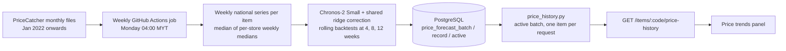

# Price history and forecasts (Epic 4)

Shows how an item's national price has moved since 2022 and, for items that pass strict quality checks, a projection for the next 4–12 weeks. Also covers *Planned items* (scheduling purchases by week), which is frontend-only.

Code: `backend/smartcart/price_history.py`, `forecast_rules.py`; weekly generation and publishing in `forecasting/` (`refresh.py`, `model.py`, `store.py`) and `.github/workflows/forecasts.yml`; tables in `database/migrations/003_price_forecasts.sql`; fallback file `backend/data/price_forecasts.json`. Frontend: `components/price-history.tsx`, `components/price-series-chart.tsx`, `lib/price-history.ts`, `lib/next-trip.ts`, `lib/planned-week.ts`.

For data preparation, checkpoint architecture, covariates, ridge features, fitting and selection, backtest metrics and evidence limits, see [Forecasting methodology](forecasting-methodology.md). For the weekly job, publishing, first activation and rollback, see [Weekly forecasts](../../forecasting/README.md) and [Forecast maintenance](../07-operations/deployment-and-operations.md#forecast-maintenance).

## How data reaches the chart

The API **never fits or runs a model**. It reads the published results and re-applies the freshness rule against today's date (Asia/Kuala_Lumpur), so a forecast can be withdrawn at runtime but never created.

## Source of the data (`SMARTCART_FORECAST_SOURCE`)

| Value | Behaviour |
| --- | --- |
| `postgres` (production since 12 Oct 2026) | Reads metadata and only the requested item from the active batch in one query. No long-lived cache, so a new weekly batch is visible without redeploying. If the database fails or has no active batch, the API returns `HISTORY_UNAVAILABLE` (503); it never falls back to an old file. |
| `file` (default) | Reads `backend/data/price_forecasts.json` (or `SMARTCART_FORECAST_PATH`) once per process. The committed file is the 9 Oct 2026 reference snapshot; it is also the bootstrap input for the first weekly run. |

Each weekly run downloads the latest PriceCatcher months, recalculates recent complete weeks (keeping older weeks from the previous verified batch), generates new paths with the frozen checkpoint and fixed settings (the ridge head is refit on data known at each origin), re-runs three recent holdouts, and publishes only if the data contains a newer complete week. Publication validates every record and switches the active pointer in one transaction; the previous batch is kept for rollback. Model selection is not repeated weekly.

## Batch contents

| Field | Meaning |
| --- | --- |
| `generated_at` | When the batch was generated |
| `data_cutoff` | Last allowed source observation date |
| `source` | Government of Malaysia PriceCatcher (CC BY 4.0) |
| `aggregation` | Median across per-store weekly medians |
| `sources[]` / `refresh_provenance` | SHA-256 of input files, model revision, rolling origins and validation evidence |
| `model_policy` | `chronos_2_small_ridge`: one pooled Chronos-2 Small model (`autogluon/chronos-2-small`, pinned revision) with a shared ridge correction; batch-generated; no request-time inference |
| `forecast_window_policy` | 52 weeks generated, **12 weeks validated**, longer horizons experimental |
| `records[]` | Per item (national scope only): weekly `history`, `forecast`, `status`, `reasons`, `coverage`, diagnostics |

Status counts: first weekly batch (generated 12 Oct 2026, cutoff 11 Oct 2026) **105 available**, 411 rejected, 274 insufficient, 6 no history (796 items). The 9 Oct reference file had 129 available.

## Forecast eligibility (`forecast_rules.eligibility`)

| Rule | Default |
| --- | --- |
| Observed weeks of history | ≥ 52 |
| Recent-week coverage | ≥ 80 % |
| Recently surveyed stores | ≥ 3 |
| Age of latest observation | ≤ 28 days (checked at request time) |
| Consistent item definition | required (mixed-brand items fail) |
| Backtest paths at 4, 8 and 12 weeks | ≥ 3 complete |
| Worst short-window relative error | ≤ 15 % |
| Error vs. latest-price baseline | ≤ 1.35 × |
| Store-composition shift | ≤ RM0.75 and must be measured |
| Annual validation / current-shape checks | optional flags, off in the current policy |

Outcomes: `no_history`, `insufficient` (< 52 weeks), `rejected` (any other failure, with human-readable reasons) or `available`. Items not in the active batch return `not_evaluated`.

> **Operational note.** Because the age rule runs at request time, forecasts expire if the weekly job stops publishing: an item loses its forecast once its latest observation is more than 28 days old. History stays visible. Check each Monday's workflow run.

### Re-qualifying the reference file

`python backend/scripts/requalify_price_forecasts.py --as-of YYYY-MM-DD` re-applies the rules to saved model paths (`research/price_forecasting/unified_results/current_shared_short_head_paths.csv`, git-ignored) and rewrites the file atomically. It only applies to the `file` source and cannot add newer data; the weekly job does that.

## What the shopper sees

| Element | Rule |
| --- | --- |
| History buttons | 3m, 6m, 1y (default), All |
| Forecast buttons | 4w, 8w, 12w (default 12w); lengths beyond the available forecast are disabled; never more than the 12 validated weeks |
| Gaps | Weeks without data have no plotted value — never zero |
| Not available | "History only · forecast unavailable"; item controls keep working |
| Price change banner | Average of the next 4 forecast weeks vs. the latest recorded price; shown only if the difference is **more than 10 %** ("Price rise forecast" / "Price drop forecast" with %) |
| Data details | Item, unit, source, aggregation, observed/missing weeks, observation count, data cutoff, generation date, model, rejection reasons, backtest error |
| Disclaimer | National estimates may differ from store prices; forecasts are planning estimates |

Forecasts **never** change basket prices, store ranking or recorded spending.

The projected-cost helper `costInsight` for archived US 4.3 was removed on 12 October 2026. Current forecasts support price-trend viewing only.

## Planned items (frontend)

Planned items let the shopper schedule a purchase for a week. Storage key `smartcart.next-trip.v1` (version 3); the code still uses the older name *next trip*.

| Rule | Implementation |
| --- | --- |
| Week | Monday–Sunday in Asia/Kuala_Lumpur, stored as the Monday's ISO date (`planned-week.ts`) |
| Choices | This week plus the next four weeks (5 options) |
| Identity | Catalogue items: `catalogue:<itemId>`; manual items keep their own ID — re-saving updates, never duplicates |
| Stored fields | Item identity, names, category, image, package size, quantity, SARA flags, planned week. **No price** — a past price is not a quote |
| Legacy items | Items saved before weeks existed have `plannedWeek = null` and are shown as "Week not set" |
| Home | "Planned this week" shows items whose week is the current week; other weeks are in the full list |
| Plan a trip | Selected catalogue items merge into the basket; an item already there keeps one line with the larger quantity. Selected manual items skip the basket and store comparison. On *Save plan*, the selected items still in the basket and the selected manual items join the checklist and leave Planned items |
| Past weeks | Stay in the list with their original week; never moved automatically |
| Clearing | Ticking a planned item *Bought* on the checklist removes it; unbought items can be scheduled from the checklist with the bookmark action |

Requirements: [Epic 4](../02-requirements/epic-4-price-history-and-planning.md), [Epic 5 US 5.6](../02-requirements/epic-5-checklist-and-trips.md).
