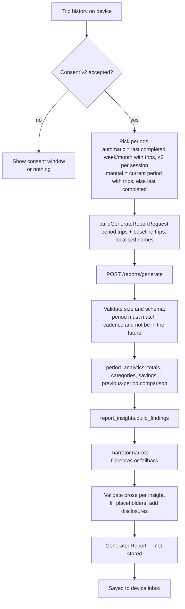

# Reports and analytics (Epic 8)

Three layers, from fully local to opt-in server processing:

| Layer | Runs | Data leaves device? |
| --- | --- | --- |
| Statistics dashboard (US 8.1, 8.3) | Browser (`lib/period-analytics.ts`, `statistics-view.ts`) | No |
| Estimated savings (US 8.2) | Browser, computed when a plan is saved (`lib/estimated-savings.ts`) | No |
| AI insight reports (US 8.5, 8.6) | Backend (`reporting.py`, `report_insights.py`, `cerebras_narrator.py`) | Yes, after consent |

## Periods

Weeks run Monday–Sunday and months run calendar month, both in Asia/Kuala_Lumpur (UTC+8). The backend `period_analytics.py` and the frontend `period-analytics.ts` implement the same rules and are checked against shared fixtures.

## Statistics dashboard

Built from device trip records only:

- **Spending and trips** for the chosen week or month; *recorded* spending is the sum of bought lines with a price. If some bought lines have no price the total is marked partial.
- **Trend** across recent periods, **spending by category** (broad categories, plus essential/discretionary/mixed classes) and **top items**.
- **Comparison** with the previous period (difference and direction), or a note that there is no previous period.
- The weekly/monthly choice is remembered (`smartcart.inbox.v1`).

Estimated figures (travel, savings) are always labelled and never added to recorded spending.

## Estimated savings

Calculated when the shopper saves a store plan and frozen into the checklist and trip record (`EstimatedSavingsSnapshot`):

| Component | Formula |
| --- | --- |
| Reference cost | Median combined total of the comparable options shown (same set of priced lines, within the travel limit); needs ≥ 2 options |
| Store-choice impact | reference − chosen plan's combined total *before* item swaps |
| Item-change impact | chosen plan before swaps − after swaps (Epic 3 swaps or plan edits) |
| Net saving | reference − chosen plan after swaps (falls back to item-change impact when there is no reference) |

The snapshot also records how many prices were median estimates and whether routes were straight-line estimates, so the UI can qualify the figure. Savings are "estimated" everywhere; a negative value is shown honestly.

## AI insight reports

### Flow

### Findings (`report_insights.py`)

Each detector compares the report period with the shopper's own baseline (previous 8 weeks or 3 months) and returns a typed finding with its numbers, pre-formatted values and bilingual template text.

| Detector | Finds |
| --- | --- |
| `detect_spending_vs_usual` | Spending clearly above or below the usual level, and its driver |
| `detect_price_changes` | Price rises/drops on items bought repeatedly |
| `detect_items_due` (weekly) | Items normally bought on a cycle that look due |
| `detect_category_shift` (monthly) | The category that moved most against its own recent average |
| `detect_store_choice` | Trips where a saved alternative store was estimated at least RM2 and 3 % cheaper |
| `detect_top_up_trips` | Many small trips that could be combined |
| `detect_repeat_skips` | Items repeatedly left unbought |
| `detect_store_record` (monthly) | How often the chosen store was at or below the typical cost |
| `detect_where_money_went`, `detect_savings_result`, `detect_unbought`, `detect_travel_share` | Current-period summaries that need no history: biggest category and item, saved-plan savings estimate, planned items left unbought, travel share of total cost |
| `detect_getting_started` | Note when history is too short for patterns |

`build_findings` ranks by priority, keeps at most four, always keeps one forward-looking card if found, and adds the getting-started note when history is thin.

### Narration and safety

- The narrator receives only findings (kind, direction, formatted values, template text), locale and cadence — never raw trips.
- The prompt requires `{{placeholder}}` tokens for every number, name and amount and forbids judgemental language; context strings are treated as data.
- Output is JSON-schema constrained, size-limited (8 KiB) and time-limited (20 s). Each insight is validated; an invalid one falls back to its template. If the call fails entirely, `FallbackReportNarrator` produces the whole report. `generationSource` says `llm` or `fallback`.
- Without `CEREBRAS_API_KEY` all reports use the fallback text; the feature still works.

### Consent and inbox (frontend)

- First eligible period → consent window explaining exactly what is sent (see [Security and privacy](../03-architecture/security-and-privacy.md)). "No thanks" sends nothing.
- *Report settings* can enable/disable AI reports and *Delete all reports*; disabling aborts any in-flight request and stops new ones, and existing reports stay until deleted. Deleting reports never touches trip history.
- Reports are stored in `smartcart.inbox.v1` (version 5). A format change clears saved reports but keeps the cadence choice.
- Report language follows the app language unless the shopper picks another (`smartcart.report-language.v1`).

## Limits

| Limit | Value |
| --- | --- |
| Request body | 512 KiB (read before parsing) |
| Trips per request | 128 |
| Bought + unbought lines | 1,000 |
| Item name | 200 characters |
| Insights per report | 4 |
