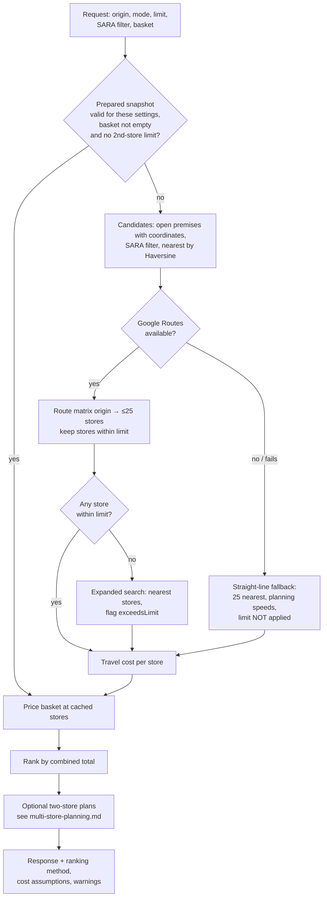

# Store recommendation (Epic 2)

Finds stores the shopper can reach within their travel limit and ranks them by the estimated total cost of buying the basket there and getting home again.

Code: `backend/smartcart/api.py` (`recommend_stores`, `_recommend_stores`), `premises.py`, `maps.py`, `recommendation.py`, `pricing.py`, `fuel.py`, `sara.py`.

## Pipeline

## 1. Candidate stores

`premises.find_nearest_premises` selects premises that:

- have a Google place ID, `open_closed_status = 'open'` and coordinates;
- match the SARA filter — `any`; `verified` → `sara_partner IS TRUE`; `candidate` → verified **or** `sara_match_candidate IS TRUE`;
- for distance and combined limits in routed mode, lie within the distance limit in a straight line (lossless: a route is never shorter than the straight line).

They are ordered by Haversine distance and capped at `ROUTE_MATRIX_CANDIDATE_LIMIT` (default 25, allowed 5–49). Each candidate's SARA status is `verified`, `candidate` or `unverified`.

Time-only limits cannot be pre-filtered by distance, so they evaluate only the nearest 25 candidates — bounded, not exhaustive.

## 2. Routes and travel limits

With a Routes key, one `computeRouteMatrix` call returns one-way distance, duration and (for transit) Google's fare for each candidate. A store passes when:

| Limit | Rule (inclusive) |
| --- | --- |
| Distance | route distance ≤ limit km |
| Time | route duration ≤ limit minutes |
| Both | both of the above |

Stores without a route result are dropped, not estimated.

**Expanded search.** If no store passes, the nearest stores are routed again without the limit and returned with `exceedsLimit = true` and a warning.

**Straight-line fallback.** If the Routes key is missing or any Routes call fails, the 25 nearest stores are returned using straight-line distance and fixed planning speeds — walk 5, public transport 25, motorcycle 30, car 30 km/h. The travel limit is **not** applied and the response says limits and routes are unverified.

Warnings are added for walking and motorcycle routes (Google beta) and for public transport (includes walking to stops).

## 3. Travel cost

| Mode | Return-trip estimate |
| --- | --- |
| Walk | RM0 |
| Public transport | 2 × Google fare when available; else 2 × RM1.00 base + RM0.08 × return km |
| Motorcycle | return km × 2.5 L/100 km × fuel price per litre |
| Car | return km × 7.0 L/100 km × fuel price per litre |

The fuel price is the latest official RON95 (or RON95 BUDI95 if `TRAVEL_FUEL_PRICE_FIELD=ron95_budi95`) from data.gov.my, fetched on the first car/motorcycle request each Malaysian day. On failure it keeps the last known price (labelled *cached*) or uses `TRAVEL_FUEL_PRICE_FALLBACK_RM` (RM2.60, labelled *fallback*) and retries after an hour. Car and motorcycle stores also get a `travelCostBreakdown` (litres, rate, price, source, effective date). Tolls, parking and ownership costs are excluded and labelled as such. All rates are environment variables.

## 4. Basket pricing

`pricing.fetch_basket_price_rows` returns one row per (store, basket line). For each line:

1. use the store's `current_status` price if it exists (`priceSource = "store"`);
2. else use `item.median_price_rm` (`priceSource = "median"`, labelled estimate);
3. else the line is unpriced: it appears in `missingItems` and is excluded from totals.

`line total = unit price × quantity`; `basket subtotal = Σ priced line totals` (Decimal, rounded half-up to cents). The subtotal is split into **SARA credit** (lines with `sara_eligible = TRUE` or a SARA-listed category) and **cash needed**. `price_observed_days_ago` reports the age of the oldest store observation (still returned; the UI no longer shows a stale-price tag).

## 5. Ranking

`combined total = basket subtotal + estimated return travel cost`, computed in Decimal so it reconciles to the cent.

Sort key (ascending), from `recommendation.apply_basket_pricing`:

1. combined total (stores with no usable price at all sort last);
2. estimated travel minutes;
3. route distance;
4. store name (case-insensitive);
5. premise ID (numeric).

With an empty basket the same key applies to travel cost alone, so the cheapest-to-reach store comes first.

## 6. Candidate snapshot (nearby prices while shopping)

`POST /recommendations/prepare` runs steps 1–3 once, without a basket, and caches the result for 30 minutes (process memory, max 128 entries, LRU). The returned `candidateCacheId` lets:

- `GET /items/search` and healthier alternatives show each product's price range across the 25 nearest cached stores (falling back to the item's median, labelled);
- `POST /recommendations` skip routing and only re-price the basket.

The cache entry stores a SHA-256 fingerprint of the travel settings; a mismatched ID is ignored. Requests with a second-store limit always bypass the cache.

## Edge cases

| Situation | Behaviour |
| --- | --- |
| No candidate stores, and open premises with Place IDs exist but none has coordinates | `503 PREMISE_LOCATIONS_NOT_READY` |
| No stores within limit | Expanded search with `exceedsLimit` (routed mode only) |
| Store has no price for any line | Shown, `combinedTotalRm = null`, ranked last |
| Google key invalid or quota exceeded | Straight-line fallback with warning |
| Price observation is old | Shown with its observed date; never treated as stock |
