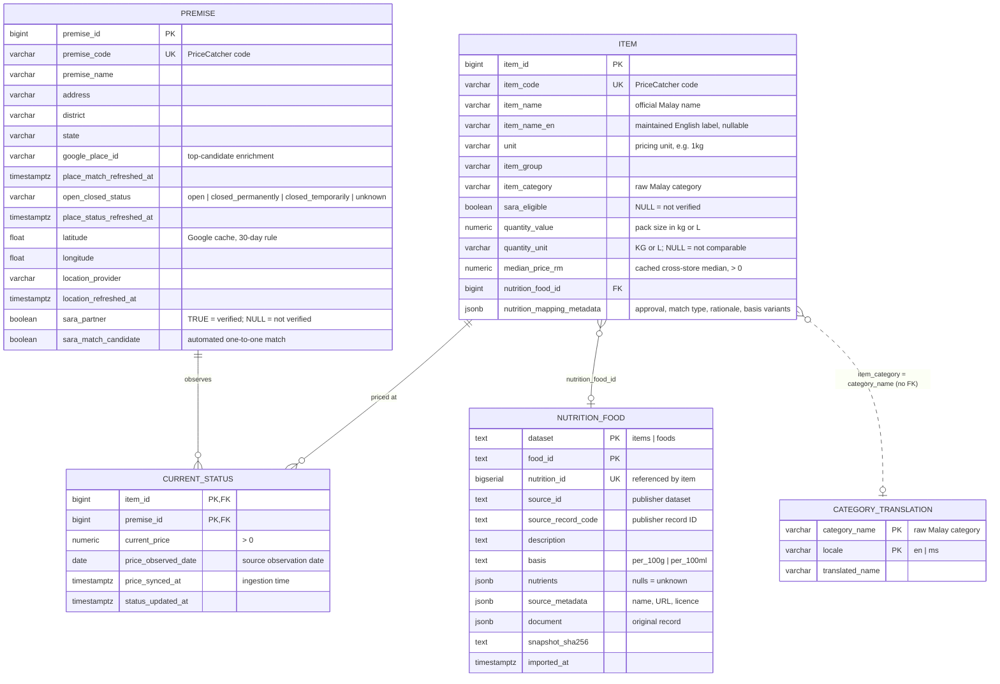
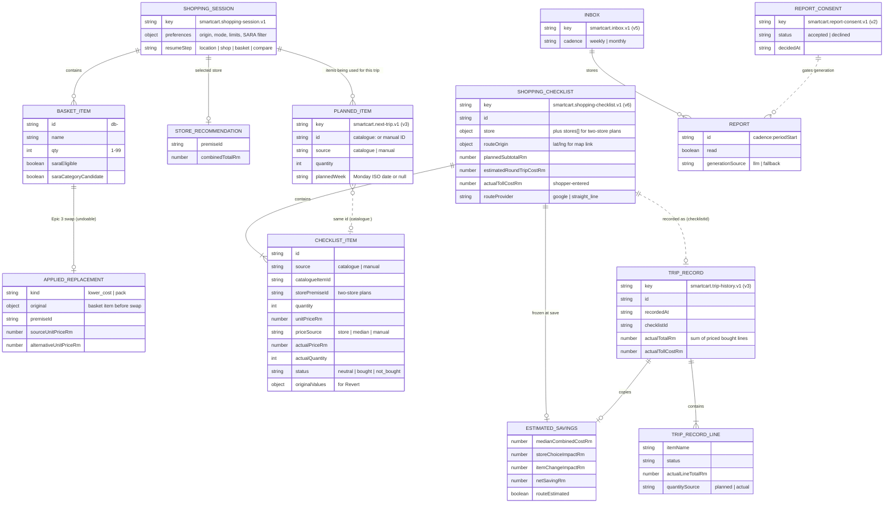
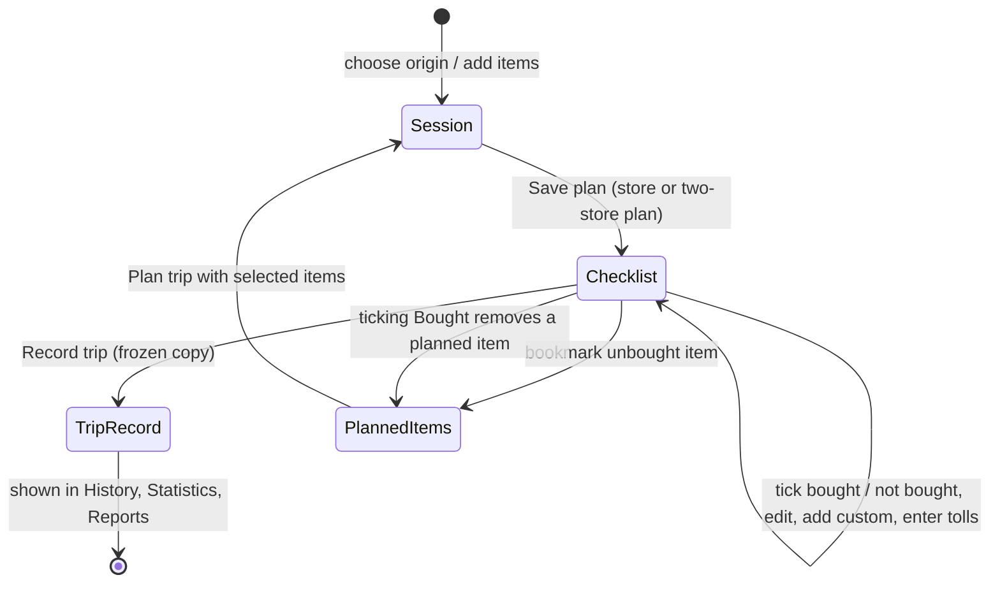

# Data model

SmartCart has two separate data models:

1. **Server data** — public catalogue, store and nutrition data in PostgreSQL, plus versioned files read by the backend. Nothing about individual shoppers.
2. **Device data** — the shopper's basket, checklist, trips, plans and reports, stored as versioned JSON in browser `localStorage`.

## Server data model

Schema: `database/schema.sql` (idempotent; safe to reapply) and `database/migrations/001_nutrition.sql`, `002_item_nutrition.sql`.

### Table notes

| Table | Rows (approx.) | Notes |
| --- | --- | --- |
| `item` | ~800 | One row per PriceCatcher item. `median_price_rm` is refreshed during ingestion for touched items and backfilled by `migrate_median_prices.py`. |
| `premise` | thousands | PriceCatcher lookup is authoritative for name and address. Place ID, status and coordinates come from the enrichment snapshot. Only `open` premises with coordinates are recommended. |
| `current_status` | one per item–premise pair with a price | Latest observation only; older observations never overwrite newer rows. A price is not proof of stock. |
| `category_translation` | 55 (English only) | Optional labels for 55 of the 59 raw categories; Malay and missing labels fall back to the raw PriceCatcher category. |
| `nutrition_food` | ~196 current foods | `items` namespace = current item profiles; `foods` = legacy reference snapshot. One table holds values and provenance; there is no separate source table. |

Key constraints: positive prices and medians; coordinates in range and set together; `open_closed_status` enumerated; JSONB columns must be objects.

Indexes: `premise (state, district)`, partial `premise (latitude, longitude)`, `premise (open_closed_status)`, `current_status (price_observed_date DESC)`, `current_status (premise_id)`, `category_translation (translated_name)`, partial `item (nutrition_food_id)`.

### Backend data files

| File | Keyed by | Contents |
| --- | --- | --- |
| `backend/data/price_forecasts.json` | `item_code` | Weekly national history, forecasts, eligibility status (see [Price history and forecasts](../04-backend/price-history-and-forecasts.md)) |
| `backend/data/nutrition/mappings.json` | `original_item_code` → `alternative_item_code` | Healthier-alternative rules and approved mappings |
| `backend/data/nutrition/comparison_policy.json` | rule ID → category | Nutrient thresholds, priorities, guards |
| `backend/smartcart/catalogue_image_manifest.py` | `item_code` | Which items have a checked-in thumbnail |
| `database/data/item_name_en.csv` | `item_code` | English item labels (seed) |
| `database/data/category_translations.csv` | raw category | Category labels (seed) |
| `database/data/archive/lookup_premise_sara_one_to_one_2026-08-23.parquet` (+ provenance JSON) | `premise_code` | Premise enrichment: candidate Place IDs and SARA candidate flags |

## Device data model

All keys are in `localStorage`. Every structured record (session, checklist, trips, planned items, inbox, consent) has a version and is validated on read; an invalid record is discarded (or migrated) rather than trusted. Parsers live next to each type in `frontend/lib/`.

### Lifecycle

Recording a trip **freezes** its lines, prices, estimates and savings; later catalogue changes never alter history. Spending figures use only lines marked bought; estimated travel is kept separately and never counted as spending.

Other keys: `smartcart-travel-preferences` (remembered preferences, no origin), `smartcart-locale`, `smartcart.report-language.v1`.
