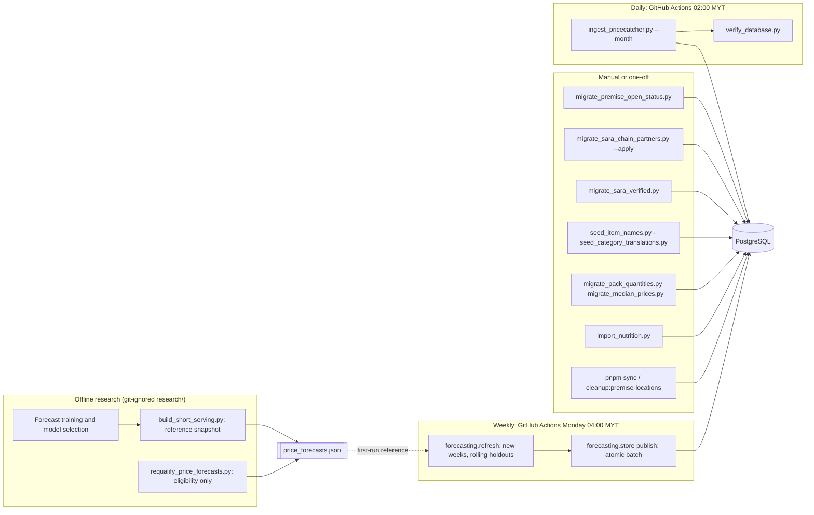

# Data sources and pipelines

## Sources

| Source | Used for | Refresh | Licence |
| --- | --- | --- | --- |
| [PriceCatcher transactions](https://data.gov.my/data-catalogue/pricecatcher) (monthly parquet) | `current_status`, `item.median_price_rm`, weekly forecast batches | Daily (current month); recent months re-downloaded weekly by the forecast job | CC BY 4.0 |
| [PriceCatcher item lookup](https://data.gov.my/data-catalogue/lookup_item) | `item` | With each ingestion | CC BY 4.0 |
| [PriceCatcher premise lookup](https://data.gov.my/data-catalogue/lookup_premise) | `premise` names and addresses | With each ingestion | CC BY 4.0 |
| Premise enrichment snapshot (2026-08-23, committed parquet + provenance) | Candidate Google Place IDs, SARA candidate flags | Manual | Derived |
| Premise status CSV + Place cache (`database/data/raw/`, not committed) | `open_closed_status`, Place coordinates | Manual | Google terms |
| Google Places (via `sync-premise-locations.mjs`) | Refresh missing or stale premise coordinates | On demand | Google terms, 30-day cache |
| [data.gov.my fuel prices](https://data.gov.my/data-catalogue/fuelprice) | Car/motorcycle travel cost | First request each day (backend) | data.gov.my terms |
| MyKasih SARA merchant list + official partner directory | `premise.sara_partner` | Manual | Authorised collection; not committed |
| USDA FoodData Central, AFCD, MyFCD | `nutrition_food` | Manual import | See [Security and privacy](../03-architecture/security-and-privacy.md#data-licences-and-attribution) |

## Pipeline overview



## PriceCatcher ingestion (`database/ingest_pricecatcher.py`)

1. Download the item and premise lookups and the monthly price file(s) to `database/data/raw/` (cache reused with `--use-cache`).
2. Validate and normalise; skip and count records whose item or premise is not in the lookup.
3. Keep the newest observation per (item, premise).
4. In one transaction: upsert items (parsing pack quantities) and premises (preserving enrichment columns), upsert `current_status` only when the incoming observation is newer, and recompute `median_price_rm` for touched items.
5. Keep only the latest six monthly files locally.

| Mode | Command |
| --- | --- |
| Initial load (January → current month) | `python ingest_pricecatcher.py` |
| Daily refresh (current month) | `python ingest_pricecatcher.py --month` |
| Specific month | `python ingest_pricecatcher.py --month 2026-09` |
| Validate only | `--prepare-only` |
| Apply committed enrichment only | `--enrichment-only` |
| Skip enrichment | `--no-premise-enrichment` |

Production runs daily through `.github/workflows/pricecatcher.yml` (cron `0 18 * * *` UTC = 02:00 Malaysia time, also manually triggerable), using the `NEON_DATABASE_URL` repository secret, then runs `verify_database.py`.

## Premise enrichment and status

- The committed snapshot holds 3,803 top-candidate Place IDs; its SHA-256 is checked against the provenance file before any database write. 1,407 premises share their top Place ID one-to-one with a SARA merchant and are stored as `sara_match_candidate = TRUE`.
- `migrate_premise_open_status.py` imports the maintained status CSV and its `.cache.json` Place coordinates. Only the selected Place's coordinates are used (never postcode geocodes). Rows whose match decision is `rejected` or `needs_review` have Place ID, status and coordinates cleared. It never calls Google and is safe to rerun.
- New PriceCatcher premises stay hidden (status NULL) until a refreshed CSV is imported.
- `pnpm sync:premise-locations -- --limit=100` (or `--all`) refreshes missing or stale coordinates for `open` premises through Google Places, paced at 300 requests/minute by default. `pnpm cleanup:premise-locations` deletes Google coordinates older than 30 days and **must be scheduled daily** wherever Google coordinates are cached.

For the production (Vercel-managed Neon) database, run migrations from the repository root so the injected production URL is used, e.g.:

```bash
npx vercel env run -e production --project smart-cart --scope tm-17 -- python database/migrate_premise_open_status.py
```

## SARA store status

Two documented routes set `premise.sara_partner = TRUE`; neither ever clears an existing flag.

| Script | Rule |
| --- | --- |
| `migrate_sara_verified.py` | Strict match to the MyKasih merchant list: Place within 150 m, ≥ 75 % of meaningful name tokens (≥ 2, incl. a brand token) fuzzy-match, postcodes agree when both present (no postcode → 90 % name coverage + same state). `--prepare-only` writes a full audit (`data/raw/sara_verified_match_audit.json`). |
| `migrate_sara_chain_partners.py` | Team-approved assumption that **all branches** of the eight chains named in the official SARA 2026 FAQ participate: Mydin, Giant, Econsave, The Store, Pacific, Milimewa, 99 Speedmart, Lotus's (incl. former Tesco). Whole-token brand matching with known variants. Preview by default; `--apply` writes and saves a JSON audit. |

`identify_sara_chains.py` and `sara_chain_catalog.py` build a reference catalogue of recurring chains from the official MyKasih partner directory for review.

Item-level SARA eligibility (`item.sara_eligible`) is not populated from a verified source yet; the app uses the official category list as a *candidate* signal.

## Catalogue maintenance

| Task | Script |
| --- | --- |
| English item names (757 rows) | `seed_item_names.py` (after `migrate_item_name_en.py` on old databases) |
| Category labels | `seed_category_translations.py` |
| Pack quantities for Epic 3 | `migrate_pack_quantities.py` |
| Median price backfill | `migrate_median_prices.py` |
| Integrity checks | `verify_database.py` |
| Stable demo data for Epic 3 | `docker-compose.demo.yml` + `seed_demo_alternatives.py` (rows prefixed `SMARTCART-DEMO-`) |
| Catalogue thumbnails | `pnpm optimize:catalogue-images` (WebP, versioned paths) |
| Chain logos | `pnpm optimize:chain-logos`; provenance in `frontend/public/chain-logos/README.md` |

## Nutrition import

See [Nutrition — maintaining the data](../04-backend/nutrition.md#maintaining-the-data). The importer validates snapshots, upserts `nutrition_food`, links `item.nutrition_food_id`, and verifies parity in the same transaction.

## Weekly forecasts

Every Monday at 04:00 MYT, `.github/workflows/forecasts.yml` refreshes forecasts and publishes them to the `price_forecast_*` tables ([Weekly forecasts](../../forecasting/README.md)). It downloads the current lookups and recent PriceCatcher months, recalculates complete Monday–Sunday weeks from individual observations (including weeks that cross a month boundary), keeps older weeks from the previous verified batch, generates paths with the frozen checkpoint and fixed settings and re-runs three rolling holdouts. Missing prices stay null, and changed item definitions are withheld until their history can be reconciled. A current-month file that is not yet published (HTTP 404) is recorded and skipped; other download failures, or no newer complete week, stop the run without publishing.

The weekly job is independent of daily `current_status` ingestion; neither job writes the other's tables. The original model selection and the 9 Oct 2026 reference file (`backend/data/price_forecasts.json`) were built in the git-ignored `research/price_forecasting/` workspace; see [Forecasting methodology](../04-backend/forecasting-methodology.md). `requalify_price_forecasts.py` only reapplies eligibility to that file.

## Data rules

- Never commit `.env`, API keys, database URLs, raw SARA collections or `database/data/raw/`.
- The PriceCatcher lookup is authoritative for item and premise names; enrichment never overwrites them.
- A price observation never implies stock; a missing value is never zero; unknown SARA status is never "not eligible".
