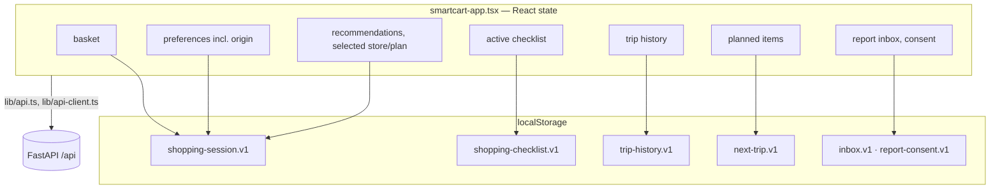

# Frontend architecture

Next.js 15 (App Router) with React 19 and TypeScript. Mobile-first, English and Malay.

## Shell and routing

The whole app is one client component, `components/smartcart-app.tsx` (`App`), mounted by `app/layout.tsx`. The files under `app/*/page.tsx` return `null`; they only make the URLs exist. `App` reads the pathname and renders the matching screen:

| URL | Screen | Main component |
| --- | --- | --- |
| `/` | Home | `SmartCartHomeScreen` in `journey-screens.tsx`; planned-items lists from `shopping-checklist.tsx` (`NextTripList`) |
| `/location` | Travel | `LocationScreen` in `smartcart-app.tsx` |
| `/shop` | Shop (catalogue) | `BasketScreen` in `smartcart-app.tsx`, `catalogue-item-dialog.tsx`, `catalogue-item-details.tsx`, `planned-items-panel.tsx` |
| `/basket` | Review basket | `BasketScreen`, `planned-items-panel.tsx` |
| `/compare` | Recommendations | `CompareScreen`, `StoreCard`, `multi-store-panel.tsx`, `plan-comparison.tsx` |
| `/store/[id]` | Store or plan details | `RecommendationOverview`, `plan-detail.tsx` |
| `/checklist` | Checklist | `shopping-checklist.tsx` |
| (any screen) | Item details from a planned item or checklist line | `item-details-dialog.tsx` (loads the item through `GET /items/lookup`) |
| `/history` | Trip history | `ReceiptHistoryScreen` in `shopping-history.tsx` (`TripHistoryScreen` in `journey-screens.tsx` is unused) |
| `/reports` | Statistics and AI reports | `report-screens.tsx`, `statistics-panel.tsx` |

`app/planner/page.tsx` is a leftover route with no screen mapping; visiting it shows Home.

Why one component: the journey shares a lot of state (basket, preferences, selected store, plans) and must survive navigation and reloads. Keeping it in one place made device persistence and step-locking straightforward. The cost is a large file (~2,900 lines); new logic should go into `lib/` modules and focused components, as most recent features do.

## State and persistence

- Each record type has a pure `serialize…` / `parse…` pair in `lib/` that validates every field and returns `null`/empty on anything invalid. Writes are wrapped in `try/catch`; if storage fails the app keeps working in memory.
- Nothing renders until storage has been read (`sessionStorageReady`), so a reload resumes exactly where the shopper was.
- Recommendation results are **not** persisted except the selected store (a selected two-store plan is kept in memory only); they are re-requested when needed.
- "Store details" in the steps bar reopens whichever was opened last, the store or the two-store plan (`lastPlanId` in `App`).
- Shop, basket and Recommendations prepare nearby stores themselves if a starting location is set and nothing is preparing them; opening the Travel screen without changing anything keeps the prepared stores.

## Module map (`frontend/lib/`)

| Area | Modules |
| --- | --- |
| API | `api-base.ts` (`NEXT_PUBLIC_API_BASE_URL`), `api.ts` (catalogue, nutrition, alternatives), `api-client.ts` (location, recommendations, store alternatives), `price-history.ts`, `contracts.ts` (shared types) |
| Basket | `basket-state.ts`, `result-row.ts`, `basket-lines.ts`, `basket-coverage.ts`, `package-size.ts`, `item-name.ts`, `catalogue-image.ts`, `catalogue-price.ts`, `estimate-label.ts` (estimated price ranges) |
| Recommendations | `travel.ts`, `visible-stores.ts`, `recommendation-detail.ts`, `multi-store.ts`, `plan-detail-edits.ts`, `trip-travel-cost.ts` |
| Journey | `shopping-session.ts`, `next-trip.ts` (Planned items), `planned-week.ts`, `item-stack.ts` (alternative navigation) |
| Checklist and trips | `shopping-checklist.ts`, `trip-history.ts`, `checklist-export.ts` |
| Savings and reports | `estimated-savings.ts`, `period-analytics.ts`, `statistics-view.ts`, `report-generation.ts`, `report-consent.ts`, `report-language.ts`, `report-format.ts`, `inbox.ts` |
| Shared | `i18n.ts` (all copy), `format-rm.ts`, `nutrition.ts` |

Rule of thumb: `lib/` modules are pure and unit-tested; components render and wire events.

## Removed code

On 12 October 2026 an export-usage scan found modules and functions that no screen used any more; they were deleted together with tests that covered only them. Removed: `ItemSearch.tsx`, `savings-insights` (component and lib), `plan-basket-items.tsx`, `success-toast.tsx`, `toast-timer.ts`, `period-summary.ts`, `overview-totals.ts`, `price-freshness.ts`, `savings-summary.ts`, `TripHistoryScreen`, the archived US 5.3 actual-price/quantity setters, the archived saving-vs-single-store display helpers, `costInsight`, and 117 unused copy strings. Older saved checklists that contain actual prices or quantities are still read correctly (`tests/fixtures/legacy-checklist.ts` builds that shape for tests). Store-level `priceObservedDaysAgo` is still returned and stored but not displayed.

## Key UI conventions

- **Steps bar** (`shopping-step-nav.tsx`): Travel → Shop → Basket → Recommendations → Store details → Checklist; later steps are locked until possible.
- **Money** is always formatted with `format-rm.ts`; estimates carry an *Estimated* label; missing values show "—" or an explicit message.
- **SARA**: store tags (`store-tags.tsx`) show verified/candidate; item labels show category candidates only.
- **Checklist export**: `checklist-export.ts` builds the export model (no network calls, enforced by a test); `shopping-checklist.tsx` renders it to an image with `html-to-image` or to PDF through the browser's print dialog, all on the device.
- **Charts**: Recharts, loaded client-side only (`price-series-chart.tsx`, `statistics-panel.tsx`); statistics charts include screen-reader tables.
- **Language**: `COPY[locale]` from `i18n.ts`; category labels through `categoryLabel()`.

## Static assets

| Path | Notes |
| --- | --- |
| `public/pricecatcher-v1/` | Versioned WebP catalogue thumbnails, served with a one-year immutable cache header (`next.config.ts`) |
| `public/chain-logos/` | Retailer logos with a provenance manifest (`README.md`, `manifest.json`) |
| `public/home-groceries.png` | Decorative home background, generated with an image-generation tool (prompt archived in `docs/archive/technical/ui-redesign-assets.md`) |

## Tooling

| Command | Purpose |
| --- | --- |
| `pnpm dev` | Dev server on port 3000 |
| `pnpm build` | Production build |
| `pnpm lint` | ESLint |
| `pnpm test` | Vitest unit tests |
| `node scripts/check-*.cjs` | Browser smoke checks against a running dev server with mocked API (needs Playwright and Chrome installed separately) |
